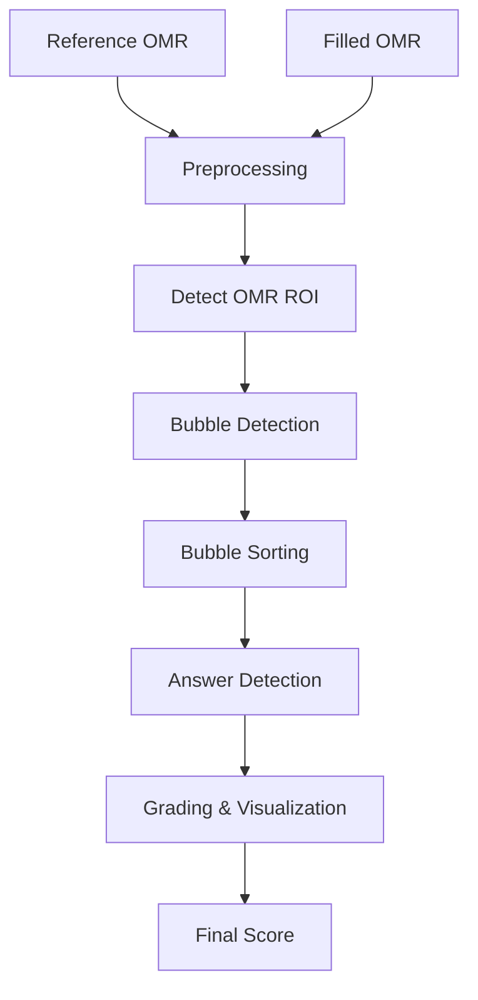

# 📄 OMR Sheet Evaluation using OpenCV

This project implements an **Optical Mark Recognition (OMR)** system using **Python and OpenCV**.
It evaluates a filled OMR sheet by comparing it against a reference (blank) OMR template and automatically calculates the final score with visual feedback.

---

## 🚀 Features

* Detects the main OMR region automatically
* Identifies and filters answer bubbles accurately
* Sorts bubbles column-wise and question-wise
* Detects marked answers using pixel density analysis
* Grades answers using a configurable answer key
* Visualizes:

  * ✅ Correct answers (Green)
  * ❌ Incorrect answers (Red)
  * ⚠️ Skipped questions (Orange)
* Displays final score directly on the evaluated image

---

## 📌 Technologies Used

* Python
* OpenCV
* NumPy
* Computer Vision techniques (Contours, Morphology, Thresholding)

---

## 🧠 How It Works (Pipeline)

1. **Preprocessing**

   * Converts image to grayscale
   * Applies Gaussian blur
   * Uses:

     * Adaptive Thresholding for reference image
     * OTSU Thresholding for filled image

2. **OMR ROI (Region Of Interest) Detection**

   * Finds the largest rectangular contour (main OMR container)
   * Crops the region of interest for accurate processing

3. **Bubble Detection**

   * Uses morphological operations
   * Filters contours based on:

     * Area
     * Aspect ratio
     * Circularity
     * Extent

4. **Bubble Sorting**

   * Sorts bubbles left-to-right (columns)
   * Then top-to-bottom (questions)

5. **Answer Detection**

   * Counts filled pixels inside each bubble
   * A bubble is considered marked if > 40% of its area is filled

6. **Grading & Visualization**

   * +2 marks for correct answers
   * −1 mark for incorrect answers
   * 0 for skipped questions
   * Draws color-coded circles on the evaluated OMR image

---

## 🧮 Scoring Logic

| Case       | Score |
|------------|-------|
| Correct    | +2    |
| Incorrect  | −1    |
| Skipped    | 0     |

---

## 🧩 Configuration

Currently configured for **20 questions**:

```python
block_of_questions = 4
questions_per_block = 5
options_per_question = 4
```

### Answer Key Format

```python
key = {
  1: "A", 2: "B", 3: "C", 4: "D",
  ...
}
```

You can easily modify this for different exams.

---

## 📂 Project Structure

```
.
├── images/
│   ├── OMR_ref2.png     # Reference (blank) OMR sheet
│   └── OMR_filled2.png  # Filled OMR sheet
├── main.py              # Main Python script
└── README.md
```

---

## 🛠️ Requirements

* Python 3.7+
* OpenCV
* NumPy

Install dependencies:

```bash
pip install opencv-python numpy
```

---

## ▶️ How to Run

```bash
python main.py
```

The program will:

* Display the graded OMR ROI with markings
* Print the final score in the console

---

## 🔄 Processing Flow



---

## 📊 Output & Visual Results

This section demonstrates the **end-to-end OMR evaluation pipeline**, from the reference template to the final graded output.

---
### 🧾 Reference OMR Template

*Used to detect the bubble layout and define the evaluation structure.*

<p align="center">
  
</p>

---
### ✍️ Filled OMR Sheet

*Student-marked OMR sheet provided as input for evaluation.*

<p align="center">
  
</p>

---
### 🔢 Bubble Indexing Visualization

*Illustrates how bubbles are detected, indexed, and mapped to questions and options internally.*

<p align="center">
  
</p>

---
### ✅ Final Graded Output

*Color-coded evaluation with score overlay:*

* 🟢 **Green** → Correct answers
* 🔴 **Red** → Incorrect selections
* 🟠 **Orange** → Skipped questions

<p align="center">
  
</p>

---
### 🖥️ Console Output

```text
Bubbles successfully filtered: 80
Detected 80 bubbles. Expected 80
Final Score: 32
```

---


## 🧩 Generate Your Own OMR Sheet (20 Questions)

To test or customize this project, you can generate your own **20-question OMR sheets** using the online OMR generator below:

🔗 **OMR Sheet Generator**
👉 [https://omrsheetgenerator.com/](https://omrsheetgenerator.com/)

### 📌 Recommended Settings

When generating the OMR sheet, use the following configuration for compatibility with this project:

* **Number of Questions:** 20
* **Options per Question:** 4 (A, B, C, D)
* **Layout:** 4 columns × 5 questions per column
* **Bubble Shape:** Circle
* **Print Scale:** 100% (no scaling)

> ⚠️ **Important:**
> Any change in layout (number of questions, columns, or options) requires updating the configuration values in the code:

```python
block_of_questions
questions_per_block
options_per_question
```

---

## 🖨️ Usage Tip

* Use the generated sheet as:

  * **Reference Image** → unfilled OMR
  * **Filled Image** → marked OMR
* Ensure:

  * Good lighting
  * Minimal skew
  * Clear bubble filling (pen/pencil)

* Use virtual environment

---

## ⚠️ Notes & Limitations

* Assumes **consistent OMR layout**
* Bubble count must exactly match configuration
* Lighting conditions should be reasonably uniform
* Currently supports **only one OMR format at a time**

---

## 🔮 Possible Enhancements

* 📄 Support multiple OMR templates
* 📦 Automatic question count detection
* 📊 CSV / Excel export
* 🖥️ GUI interface
* 🤖 ML-based bubble classification
  
---
